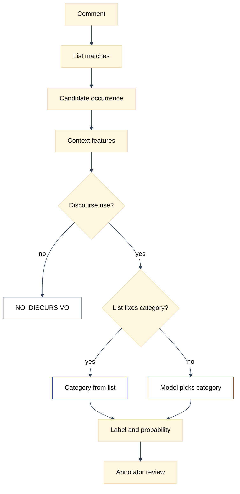
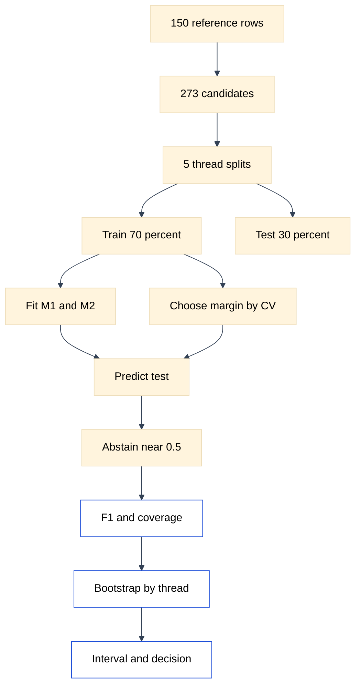

# Onboarding — the project in one page

This page is the shared vocabulary. Read it before the brief, the spec, or the
code. It is written in English because the code, commits, and agent notes are
English; the team-facing README stays Spanish.

## 1. The story in order

**Who.** Equipo 11 (Diana Aguilera Fredes, Vannia Fernández-Mutis, and now Till
Seyfarth) works on Fondecyt 11260185: annotating discourse connectors and
operators in Chilean Spanish YouTube comments, following Fuentes Rodríguez
(2009).

**What exists.** The current proposal is
`doc/Equipo11_Propuesta_v4_hito2.docx`; v3 is superseded. The pilot notebook is
`doc/equipo11_B0_B1_M1_M2.ipynb`. The published results are
`doc/resultados_hito2.zip`. The reference annotation is
`doc/referencia_piloto.csv`. The Fuentes list is
`doc/listado_fuentes2009.csv`. The input audit is
`docs/results/data-overview/inputs-audit.md`.

**What the team did first.** They annotated 150 comments from the pilot
workbook. They built candidates by matching every form in the Fuentes list
against the comment text. They ran two baselines and two models over five seeds,
splitting by thread. They published the table and the per-seed predictions.

**The result.** M2 averages **0.483** exact-label F1 against **0.328** for B1.
Coverage is **0.407**, precision **0.599**, and mean abstention **15.6%**. The
mean gain is **+0.155**, but the bootstrap interval excludes zero in only **one
of five seeds**. The v4 proposal already declares this: the criterion is met on
average, not in significance.

**What this repository is for.** Make those numbers reproducible and testable,
then extend the same pipeline to the application corpus. The repository does not
tidy the notebook away; it turns the notebook's behaviour into code with tests
and an honest report.

## 2. The five ideas

| Idea | What it means here | Concrete example |
|---|---|---|
| **Occurrence** | The unit is one match of a list form in one comment, not one comment. A comment with three list words yields three rows, each with its own gold label. | 150 reference rows produce **273 candidates**, of which 64 have a gold label. |
| **Feature** | A measurable property of the occurrence's context that a model can consume. | For `hasta`: the next word is an article, number or time → likely preposition. For `ya`: sentence-initial plus a following comma → likely operator. |
| **Logistic regression** | A small classifier that turns features into a probability. M2 uses two: first P(discourse use), then a category among those the list admits. It is the only thing trained. | If P(discourse) is near 0.5, the system abstains instead of guessing. |
| **Embedding** | A frozen sentence encoder maps the ±6-word window to 384 numbers. It is not trained; it just converts context to numbers. | `paraphrase-multilingual-MiniLM-L12-v2`, CPU-only. |
| **Evaluation** | How we know whether it works: thread split, 5 seeds, a frozen test per seed, exact-label F1 as primary, bootstrap by thread. | A comment and its replies never land on different sides of the split. |

## 3. Reading one number: 0.483

The published table reports the **mean over five seeds**. The five M2 scores are
0.432, 0.545, 0.500, 0.452 and 0.486; 0.483 is their mean, not a single run.

**F1** is the harmonic mean of precision and recall. Here the label is the full
category, so a prediction counts only if it matches the reference exactly
(`CON:ADICIÓN` is not `CON:ADICION`).

- **Precision 0.599** — of the labels the system emits, about 60% are exactly
  right. The other 40% are false alarms the annotator must reject.
- **Coverage 0.407** — of all discourse labels in the test threads, the system
  recovers about 41% exactly. The denominator includes the **16 labels the list
  never sees**, so the system is charged for its blind spots. The hard ceiling is
  **0.8**: 16 of the 80 evaluated labels cannot be detected by the list.
- **Where the loss sits** — precision is the stronger side. The system misses
  more than it invents. That is why coverage, not precision, is the number to
  watch.
- **F1 of discourse use 0.606** — the binary question "is this discourse?" is
  easier than "which category?". The gap of about 0.12 is category error, not
  detection error.
- **Abstention 15.6% on average** — the margin is learned by grouped
  cross-validation inside training. Seeds 2 (**30.4%**) and 4 (**21.3%**) exceed
  the 20% cap in `gate.toml`, so R3 is violated in two seeds. Abstention lifts F1
  to 0.513 by dropping uncertain candidates; it is not free.
- **M2 − B1** — the mean gain is +0.155. Per seed it is −0.012, +0.317, +0.222,
  +0.185 and +0.062. The bootstrap interval excludes zero only in seed 3. The
  headline is a promising point estimate, not a robust result.
- **M2 − M1** — the mean gain is +0.123, with the interval excluding zero in 2 of
  5 seeds. This is the evidence that the linguistic knowledge adds something.
- **R6 latency** — p95 0.081 s per comment on CPU, well under the 1 s target.
- **R7 traceability** — 91 discourse labels across the five tests; the list fixed
  the category of 58 (34 correct), the model chose 33 (20 correct); 43 (47%) were
  marked "revisar categoría".

What the numbers do **not** mean:

- They are not production accuracy on the application corpus. The application
  corpus has no reference labels, so its F1 cannot be measured.
- They are not five independent samples; the five seeds share the same 150
  reference rows and only the thread split changes. Every comment reaches a test
  in some seed, so this is a repeated grouped holdout, not one frozen test.
- They do not settle the precision/recall trade-off. That is a design choice.
- They do not prove the notebook reproduces locally. The local versions differ
  from Colab (pandas 3.1.1, scikit-learn 1.9.1, spaCy 3.8.18, torch 2.15).
- The **209 implicit negatives** are a caveat. The annotation marks connectors,
  not every non-connector. Of the 209 negatives, 84 come from rows marked "Sin
  etiquetas" and 125 sit inside comments that were annotated. If annotators only
  marked what caught their eye, the gold contains silent misses, which depresses
  recall. The audit proposes checking 20 unmarked candidates.

**F1 or F2?** F1 weights precision and recall equally. F2 weights recall twice as
much, which matches the project's rule that a missed connector is worse than a
false alarm. The v4 proposal makes full-label F1 primary and reports coverage,
abstention, "revisar categoría", latency, and provenance as secondary. Whether to
add F2 on the binary decision or coverage-at-budget is an open question for the
brief; it is not decided here.

## 4. The two flows

### Annotation flow: one comment to one label

### Experiment flow: labels to an interval

## 5. Glossary

| Term | Meaning |
|---|---|
| **List form** | A string in `doc/listado_fuentes2009.csv`, e.g. `ya`, `hasta`, `solo`. |
| **Candidate** | One list-form match in one comment, with a start offset. |
| **Reference / gold** | The human annotation. `NO_DISCURSIVO` or a `CON:`/`OP:` label. |
| **CSL** | *Construcción semilibre*: a multi-word pattern whose function belongs to the whole, not to one word. Excluded from evaluation. |
| **Implicit negative** | A candidate with no gold label. The protocol assumes it was reviewed and rejected. |
| **Baseline B0** | Label every match with the list's first category, ignoring context. |
| **Baseline B1** | Label each form with its most frequent label in training. |
| **M1** | Two-step logistic regression on context features. |
| **M2** | M1 plus the list restriction, hand-written context rules, spaCy POS, rare-category flag, and provenance. |
| **M3** | The planned rules layer that decides before the model. Due 25 November; not in the notebook. |
| **Margin** | The distance from 0.5 below which the system abstains. Learned in training. |
| **Thread** | A top-level comment plus its replies. The split unit. |
| **Seed** | One of 0–4. Each seed gives a different thread split. |
| **Frozen test** | The thread IDs fixed before training for that seed, with a hash in `hashes.json`. |
| **Bootstrap** | Resampling threads to estimate the interval of a difference. |
| **Leakage** | Test information reaching training. Here, a reply in test whose parent is in train. |
| **R1–R7** | The proposal's requirements: detection, classification, abstention, cost, privacy, latency, traceability. |
| **R5** | The privacy rule: no comment text, no context window, no `author_hash` in git. |

## 6. Artefact map

| Path | What it is |
|---|---|
| `doc/Equipo11_Propuesta_v4_hito2.docx` | The current proposal: R1–R7, restrictions a)–e), milestones. |
| `doc/Justificación de parámetros y requisitos · Equipo 11.docx` | The parameter and requirement justification. |
| `doc/listado_fuentes2009.csv` | 705 rows, 614 forms, 548 single-category. |
| `doc/referencia_piloto.csv` | 150 reference rows from one video; 65 with a label; annotation inline as `[unidad::ETIQUETA]`. |
| `doc/csl_excluidas.csv` | 16 CSL occurrences to exclude. |
| `doc/resultados_hito2.zip` | Published predictions, per-seed results, intervals, frozen test IDs and hashes. |
| `doc/equipo11_B0_B1_M1_M2.ipynb` | The reference implementation, including its mistakes. |
| `gate.toml` | Frozen protocol constants: seeds, split fraction, abstention cap, window, model. |
| `docs/state.md` | Handoff: where we are, what is blocked, gotchas. |
| `docs/results/data-overview/` | The corpus overview and input audit. |
| `docs/research/local-llm-annotation.md` | Future work: a local open LLM as a measured teacher. |
| `docs/adr/` | Decisions that change what a result means. |
| `docs/design/` | Design notes from `/learn`. |
| `docs/learn/` | Concept notes from `/learn`: window, TF-IDF, embeddings. |
| `docs/specs/` | Contracts from `/spec`. |
| `docs/results/` | Slice diagnostic reports. |
| `src/conectores/` | Package code. Empty beyond the version string. |
| `tests/` | Test suite. One package test today. |
| `.opencode/commands/` | The workflow commands: `/onboard`, `/grill`, `/plan`, `/learn`, `/spec`, `/tdd`. |

## 7. Data facts and discrepancies

- The listing has **705 rows** but **699 distinct raw strings**; six units appear
  twice with different categories. After stripping the trailing numbering there
  are **614 forms**, 548 single-category and 66 multi-category; 155 rows are
  marked polyfunctional. The v4 requirement R1 says "705 unidades" but its
  verification says "614 de 614 formas detectadas". The brief should choose one
  wording.
- The reference has **150 rows**, but only **65 rows carry a label**. The 96
  spans cover 76 distinct units (67 after lowercasing) in 12 labels. The other 85
  rows say "Sin etiquetas" and contribute 84 negative candidates. "150 annotated
  comments" means reviewed, not labelled.
- The 96 labels decompose as **64 detectable + 16 not in the listing + 16 CSL**.
  After removing CSL, 80 remain: 64 detectable and 16 undetected. The 273
  candidates are 284 raw matches minus 8 inside CSL and 3 second pieces of a
  longer unit. Of the 273, 64 are positive and 209 are implicit negatives.
- The pilot workbook (`doc/Corpus piloto youtube__anotado.xlsx`) has **1,268
  comments, 6 videos, 798 threads**; 399 are normalised and 150 are reference
  rows. All 150 reference rows come from **one video** (fuel prices). The
  reference's comment IDs are **not** in the application corpus.
- The application corpus (`doc/comentarios_youtube.csv`) has **10,505 comments,
  6,264 threads, 20 videos**. The listing finds **19,741** candidates on the raw
  text and **20,097** on the normalised text. The v4's 2,000-comment sample has
  **3,655 candidates**, 22.5% abstention, 11.6% discourse among non-abstained
  candidates, and 54 CSL candidates in 51 comments.
- The reference is **closest to Vannia's annotation** (58 of 65 labelled rows
  identical), then Jorge (31), Javier (19), and Hernán (3). **143 of 150** rows
  have two or more real annotations; `anotacion_final` covers only **48** of the
  65 labelled rows. Pairwise exact agreement is **50–59%** when both annotators
  marked something. Hernán's column looks like working text, not an independent
  annotation.
- The five seeds are **repeated grouped holdouts** of the same 150 rows. Each
  seed has its own frozen test IDs and hash. Every comment reaches a test in some
  seed. The 27–28 November evaluation is the official final one.
- The local versions differ from Colab. The published 0.483 may not reproduce
  exactly; checking that is a first-order risk.
- `cobertura_etiqueta` in the notebook is **exact-label recall**, not detection
  recall (~0.41 vs ~0.51).
- The v4 proposal reports **two independent runs with identical hashes and
  results**. That is the team's claim; this repository has not verified it.

## 8. Open questions for the brief

1. **F1 or F2?** Keep full-label F1 primary and add F2 or coverage-at-budget as a
   secondary diagnostic, or make both co-primary?
2. **Primary audience.** The team's annotator, external Fondecyt researchers, or
   both? The review queue and report shape depend on it.
3. **Reproduce or reimplement first?** The published predictions are a ready
   yardstick; a fresh implementation is a better teacher. The order changes what
   a mismatch means.
4. **Reference set.** Closed at 150 for now, may grow later. Who owns a future
   expansion and how is agreement measured?
5. **Application run.** Who owns the 25 November run, and which candidate count
   should it use: 19,741 or 20,097?
6. **Adjudication.** How was the single `anotacion` column chosen, given that
   `anotacion_final` covers 48 of 65 rows and the reference matches Vannia in 58
   of 65? What is Hernán's role?
7. **Implicit negatives.** Was every candidate reviewed, or only the salient
   ones? An audit of 20 unmarked candidates would settle whether the 209
   negatives are trustworthy.
8. **Application artifacts.** The v4's 2,000-comment results are not in
   `resultados_hito2.zip`. Where are the application predictions?
9. **M3 ownership.** Who runs the 40-case manual review where M3 and M2 disagree?
10. **Git remote.** None configured; the proposal still says "pegar enlace".

## 9. Next

The current slice order is in [`docs/plan.md`](plan.md) and the live handoff is
in [`docs/state.md`](state.md). The original recommended order was:

- **A — Metric replay.** Reimplement the published table from
  `predicciones_test.csv` with no model. This gives a trusted yardstick and
  teaches F1, coverage, abstention and the bootstrap.
- **B — Candidate replay.** Reimplement candidate construction from the
  reference and match 273 candidates, 64 positive, 16 undetected, 8 CSL.
- **C — Baseline replay.** Reimplement B0 and B1 and compare per-seed numbers.
- **D — Model replay.** Reimplement M1 and M2, including the frozen rules and the
  margin.
- **E — Embedding ablation.** The 21 November benchmark, with and without
  embeddings. This is a team deliverable, not just a learning slice.
- **F — M3 rules.** The 25 November rules layer and the 40-case review. This is a
  team deliverable and needs the frozen rules.

Slice A is the cheaper yardstick. Slice B is the more direct reimplementation.
The author picks.

## 10. Going deeper

The [`docs/learn/`](learn/README.md) folder holds the concept notes from the
`/learn` sessions:

- [Candidate window and the six flags](learn/01-candidate-window.md)
- [TF-IDF](learn/02-tf-idf.md)
- [Window embeddings](learn/03-window-embeddings.md)
- [B0 versus B1](results/0003-baseline-replay-diagnostics.md#the-two-rules-at-a-glance)
- [Candidate categories](results/0002-candidate-replay-diagnostics.md#worked-examples)

The spec and the slice report remain the contract and the evidence; the notes
explain.

Next: `/learn <slice>`.
