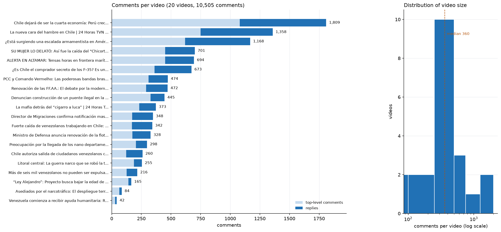
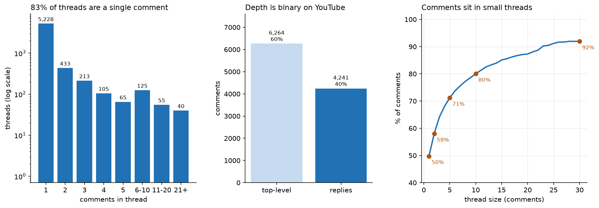

# Corpus overview — application corpus and pilot reference

**Date:** 2026-11-20
**Status:** exploratory data description, not a slice
**Owner:** Till
**Sources:** `doc/comentarios_youtube_normalizados.csv` (application corpus) and
`doc/referencia_piloto.csv` (pilot reference). Both are local only and gitignored;
they contain comment text and must never be published (R5).

This note answers three questions before any modelling: how many videos there
are, what they are about, and how comments are nested.

## How this was produced

Only metadata columns were read (`video_id`, `video_title`,
`video_channel_title`, `video_published_at`, `comment_id`,
`parent_comment_id`, `thread_id`, `is_reply`, `total_thread_replies`). No
comment text entered the analysis, the figures, or this note.

Depth is computed by following `parent_comment_id` upwards until the chain ends
or reaches the thread. Thread size is the number of comments sharing a
`thread_id`.

```powershell
.\.venv\Scripts\python.exe docs/results/data-overview/make_figures.py
```

The script regenerates the two figures and the three data files next to it. It
needs the corpus in `doc/`, which is not versioned.

## Headline numbers

| | |
|---|---|
| Videos | **20** |
| Channels | 3 — Meganoticias 6,391 · 24 Horas TVN 2,421 · CHV Noticias 1,693 |
| Comments | 10,505 |
| Threads | 6,264 |
| Top-level comments | 6,264 (59.6 %) |
| Replies | 4,241 (40.4 %) |
| Comments per video | 42–1,809, median **360**, mean 525 |
| Largest video | 1,809 comments (17.2 % of the corpus) |
| Video publication dates | 19 videos April–November 2026, 1 from March 2023 |
| Comment dates | 2023-03-21 → 2026-11-14 |

## Are they all political?

Not in the party-politics sense. All 20 are public-affairs news pieces from
national outlets. Grouping the titles approximately:

| Theme (author's grouping) | Videos | Comments |
|---|---:|---:|
| Security and defence — F-35, regional rearmament, FF.AA., Chabunco, maritime border | 5 | 3,335 |
| Migration — Colchane, Migraciones, Venezuelan workers and expulsions | 5 | 1,611 |
| Crime and narco — Chicorte, PCC, cigarro a luca, litoral, narcotráfico | 5 | 1,887 |
| Social and economic — FMI/Peru, hunger, nano-apartments, Ley Alejandro, earthquake aid | 5 | 3,672 |

The corpus has no topic labels; this grouping is inferred from titles and is
only meant to show the mix. The pilot, by contrast, is about the fuel-price
hike, a topic that does not appear in the application corpus at all.

## Comments per video

The bar chart is sorted, with top-level comments in light blue and replies in
dark blue. The right panel is the histogram of the same counts, on a log axis:
half the videos have 250–500 comments, two have more than 1,250, and one has 42.



*Figure 1. 10,505 comments over 20 videos. The distribution is heavily skewed;
one video holds 17 % of the corpus.*

## Threads and comment depth

Depth is only ever 1 or 2:

```
Video
└─ Thread root ........................ depth 1   (6,264 · 60 %)
   ├─ reply .......................... depth 2   (4,241 · 40 %)
   └─ reply .......................... depth 2
```

All 4,241 replies have the thread root as their parent (100 %). This is not a
download defect: YouTube has two levels only, and a reply to a reply stays in
the same thread at the same level. Consequences:

- depth carries no information beyond `is_reply`, so a depth feature would be a
  duplicate;
- 5,228 of 6,264 threads (83.5 %) contain a single comment, holding 49.8 % of
  all comments;
- 71 % of comments sit in threads of five or fewer, 80 % in ten or fewer, 92 %
  in thirty or fewer; the largest thread has 110.



*Figure 2. Thread size on a log scale, the binary depth, and the cumulative share
of comments by thread size.*

## The pilot reference is narrower than it looks

| | |
|---|---|
| Rows | 150 |
| Rows with at least one label | **65** |
| Label spans | 96 |
| Distinct units | 76 |
| Distinct labels | 12 |
| Distinct video titles | **1** |
| Comment IDs shared with the application corpus | **0** |

So "150 annotated comments" means 150 comments reviewed, of which 65 contain a
label. The 273 candidates used by the notebook come from all 150 rows. The
counts are reproduced in `reference_summary.txt`; comment text is not published.

## What this means for the project

1. **The evaluation base is 65 labelled comments and 96 labels from one video.**
   That is the direct explanation for the wide confidence intervals, not just
   "a small test".
2. **Splitting by thread is not splitting by video.** All five seeds share the
   same video, topic, and comment section. The model is tested on new threads
   from a known video; generalisation to a new video is untested.
3. **The topic shift is total.** Training on fuel prices and applying to
   migration, defence, and narco is a change of domain. The rise in abstention
   from 15.6 % to 22.5 % is consistent with that, though without labels it
   cannot be separated from normalisation or unit-mix effects.
4. **The application-corpus aggregates are dominated by a few videos.** One
   video is 17 % of comments and one channel is 61 %, so pooled rates should be
   reported per video or per channel, not only as one number.

## Open questions

- The proposal says the pilot has 6 videos; the reference file has one title for
  all 150 rows. Confirm whether the annotation covers one video or six.
- The `video_id` column of `referencia_piloto.csv` contains a video *title*, not
  an ID, unlike the application corpus. This should be fixed or documented.
- Where are the application-corpus artifacts (`aplicacion_*.csv`) behind the v4
  figures? They are not in `resultados_hito2.zip`.

## Files

| File | Content |
|---|---|
| `make_figures.py` | regenerates everything below from `doc/` |
| `videos_summary.csv` | per-video counts: comments, threads, top-level, replies |
| `depth_counts.csv` | comments per depth level |
| `reference_summary.txt` | the pilot reference counts in plain text |
| `fig1_comments_per_video.png` | comments per video, stacked, plus histogram |
| `fig2_threads_depth.png` | thread size, depth, cumulative share |
